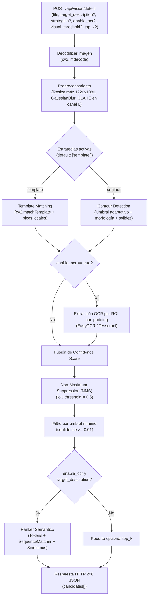

# vision-service (v1)

Microservicio de percepción visual para automatización de pruebas web mediante detección de elementos UI basada en **OpenCV (Template Matching + Contours)** y **OCR (EasyOCR / Tesseract)**.

---

## 1. Visión General

**Problema que resuelve:**
Proporciona capacidades de visión computacional para frameworks de automatización web (como Playwright, Selenium o Cypress) que necesitan **localizar e interactuar con elementos de interfaz** (botones, tarjetas de producto, íconos, inputs) a partir de capturas de pantalla, sin depender de selectores CSS o XPath frágiles.

**Responsabilidades principales en v1:**
- Administrar en memoria un banco dinámico de plantillas visuales (*templates*) por sesión o entorno.
- Localizar elementos mediante **Template Matching** con detección de picos locales (estrategia por defecto) y **Contour Detection** (estrategia opcional/fallback).
- Extraer texto y nivel de confianza de cada región candidata mediante **OCR** (`EasyOCR` por defecto o `Tesseract`).
- Calcular un score de confianza combinado, filtrar solapamientos con **Non-Maximum Suppression (NMS)** y ordenar semánticamente los candidatos según una descripción objetivo y sinónimos de dominio.
- Devolver el `bbox`, el punto exacto de clic (`center_point`), el `template_id` detectado y el detalle del motor OCR (`ocr_details`).

---

## 2. Arquitectura del Servicio

El microservicio sigue una **arquitectura en capas** desacoplada del framework de pruebas:

```
┌────────────────────────────────────────────────────────┐
│                 Capa API REST (FastAPI)                │
│  POST /api/vision/templates/register                   │
│  POST /api/vision/templates/clear                      │
│  POST /api/vision/detect                               │
│  GET  /health                                          │
└───────────────────────────┬────────────────────────────┘
                            │
                    ┌───────▼────────┐
                    │   Perception   │  ← Orquestador del Pipeline
                    │     Engine     │    (Preprocesamiento, Score, NMS)
                    └───────┬────────┘
            ┌───────────────┼───────────────┐
            │               │               │
     ┌──────▼──────┐ ┌──────▼──────┐ ┌──────▼──────┐
     │  Template   │ │   Contour   │ │ OCR Engine  │
     │   Matcher   │ │  Detector   │ │ (EasyOCR /  │
     │  (default)  │ │ (opcional)  │ │  Tesseract) │
     └─────────────┘ └─────────────┘ └─────────────┘
```

### Componentes Principales

| Componente | Ubicación | Responsabilidad |
|-----------|-----------|-----------------|
| **APIRouter** | `app/api/v1.py` | Expone los endpoints de ciclo de vida de templates y detección híbrida |
| **PerceptionEngine** | `app/vision/perception.py` | Preprocesa la imagen, ejecuta estrategias activas, fusiona scores y aplica NMS |
| **TemplateMatcher** | `app/vision/template_matcher.py` | Correlación `cv2.TM_CCOEFF_NORMED` en escala de grises con extracción de máximos locales |
| **ContourDetector** | `app/vision/contour_detector.py` | Binarización adaptativa, morfología y filtrado de contornos por área y solidez |
| **OCRModule** | `app/vision/ocr.py` | Extracción de texto sobre cada ROI detectada (`easyocr` con lector cacheado o `tesseract`) |
| **Ranker** | `app/vision/ranker.py` | Ranking semántico (`SequenceMatcher` + coincidencia por tokens y sinónimos de dominio) |
| **ElementCandidate** | `app/vision/models.py` | Modelo de datos de salida (`bbox`, `center_point`, `confidence_score`, `meta`, `ocr_details`) |
| **VisionConfig** | `app/core/config.py` | Parámetros centralizados y lectura de variables de entorno |

---

## 3. Pipeline de Detección (`POST /api/vision/detect`)



---

## 4. Especificación de la API REST

### 4.1 Healthcheck
- **GET** `/health`
- **Respuesta (200 OK):**
  ```json
  { "status": "ok" }
  ```

### 4.2 Registrar Template en Memoria
- **POST** `/api/vision/templates/register?template_name={nombre}`
- **Parámetros:**
  - `template_name` (query, requerido): Identificador de la plantilla (ej. `add_to_cart`, `svelte-product-card-container`).
  - `file` (form-data, requerido): Imagen PNG/JPG de la plantilla.
- **Respuesta (200 OK):**
  ```json
  {
    "status": "registered",
    "template_name": "add_to_cart",
    "templates_count": 1
  }
  ```

### 4.3 Limpiar Banco de Templates
- **POST** `/api/vision/templates/clear`
- **Respuesta (200 OK):**
  ```json
  {
    "status": "cleared",
    "templates_cleared": 1
  }
  ```

### 4.4 Detectar Elementos en Captura
- **POST** `/api/vision/detect`

#### Parámetros

| Parámetro | Ubicación | Tipo | Default | Descripción |
|---|---|---|---|---|
| `file` | `form-data` | `UploadFile` | *(requerido)* | Captura de pantalla (PNG/JPG) a analizar |
| `target_description` | `query` | `string` | `None` | Texto objetivo para activar el ranking semántico (ej. `"Add to cart"`) |
| `element_type` | `query` | `string` | `None` | Tipo esperado para bonificación en ranking (ej. `"button"`) |
| `synonyms` | `query` | `list[str]` | `None` | Sinónimos aceptados (repetidos `?synonyms=a&synonyms=b` o separados por coma `?synonyms=a,b`) |
| `strategies` | `query` | `list[str]` | `["template"]` | Estrategias a ejecutar: `template`, `contour` o `template,contour` |
| `enable_ocr` | `query` | `bool` | `true` | Ejecuta extracción OCR en cada ROI y habilita ranking semántico |
| `visual_threshold` | `query` | `float` | `0.6` | Umbral mínimo de correlación para Template Matching (`0.0` a `1.0`) |
| `top_k` | `query` | `int` | `None` | Limita la cantidad máxima de candidatos devueltos |

#### Ejemplo de Request
```bash
curl -X POST "http://localhost:8001/api/vision/detect" \
  -F "file=@tests/assets/datasets/home_page-react.png" \
  -G \
  --data-urlencode "target_description=Add to cart" \
  --data-urlencode "synonyms=bag,carrito,agregar" \
  --data-urlencode "visual_threshold=0.6"
```

#### Ejemplo de Response (200 OK)
```json
{
  "status": "success",
  "candidates_count": 1,
  "candidates": [
    {
      "candidate_id": "c_7f8043ea",
      "source_strategy": "template",
      "element_type": "unknown",
      "semantic_text": "Agregar al carrito",
      "role": null,
      "center_point": {
        "x": 991,
        "y": 580
      },
      "bbox": {
        "x": 906,
        "y": 551,
        "width": 171,
        "height": 59
      },
      "confidence_score": 0.9187,
      "reasoning": "Detected via template strategy",
      "meta": {
        "template_id": "add_to_cart",
        "template_score": 0.9412,
        "visual_score": null,
        "ocr_confidence": 0.885,
        "area_pixels": 10089
      },
      "ocr_details": {
        "engine": "easyocr",
        "text": "Agregar al carrito",
        "confidence": 0.885
      }
    }
  ]
}
```

#### Respuestas de Error (400 / 500)
```json
{
  "error": "Failed to decode image"
}
```

---

## 5. Configuración y Variables de Entorno

### Variables de Entorno (`.env.example`)

| Variable | Valor por Defecto | Descripción |
|---|---|---|
| `PYTHONUNBUFFERED` | `1` | Salida de logs sin buffer en contenedor Docker |
| `VISION_API_URL` | `http://localhost:8001/api/vision` | URL base del servicio consumida por clientes y tests |
| `VISION_OCR_ENGINE` | `easyocr` | Motor de OCR activo (`easyocr` o `tesseract`) |
| `VISION_OCR_LANGUAGES` | `en,es` | Idiomas cargados por EasyOCR (sincronizado con `ARG EASYOCR_LANGS` del `Dockerfile`) |

### Parámetros Principales (`app/core/config.py`)

| Parámetro | Valor | Descripción |
|---|---|---|
| `TEMPLATE_MATCH_THRESHOLD` | `0.6` | Umbral por defecto para `cv2.TM_CCOEFF_NORMED` |
| `OCR_CONFIDENCE_THRESHOLD` | `0.3` | Confianza mínima por palabra leída en OCR |
| `ROI_PADDING_RATIO` | `0.1` | Expansión del recorte (10%) antes de pasar por OCR |
| `NMS_IOU_THRESHOLD` | `0.5` | Umbral de solapamiento IoU para suprimir detecciones duplicadas |
| `CONFIDENCE_MIN_THRESHOLD` | `0.01` | Umbral mínimo global de descarte |
| `RANKING_MIN_RELEVANCE` | `0.5` | Relevancia mínima exigida cuando se filtra por `target_description` |
| `PREPROCESS_MAX_WIDTH` / `HEIGHT` | `1920` / `1080` | Dimensiones máximas de preprocesamiento |

---

## 6. Stack Tecnológico y Licencias

Las dependencias de ejecución se encuentran fijadas en `requirements.txt` y las herramientas de prueba/desarrollo en `requirements-dev.txt`. Todas las librerías utilizan licencias abiertas permisivas (compatibles con uso académico y comercial, sin restricciones *copyleft* tipo GPL/AGPL):

| Librería / Herramienta | Versión | Licencia | Propósito |
|---|---|---|---|
| **FastAPI** | `0.142.2` | MIT | Framework REST API |
| **Uvicorn** | `0.54.0` | BSD-3-Clause | Servidor ASGI |
| **OpenCV Headless** | `5.0.0.93` | Apache-2.0 | Template Matching, Contornos, CLAHE y Morfología |
| **NumPy** | `2.2.6` | BSD-3-Clause | Operaciones matriciales |
| **Pillow** | `12.3.0` | MIT-CMU | Manipulación de imágenes |
| **EasyOCR** | `1.7.2` | Apache-2.0 | Reconocimiento óptico de caracteres basado en Deep Learning |
| **PyTorch / TorchVision** | `2.14.1` / `0.29.1` (CPU) | BSD-3-Clause | Backend de inferencia CPU para EasyOCR |
| **Tesseract OCR + pytesseract** | System / `0.3.13` | Apache-2.0 | Motor OCR clásico alternativo |
| **python-multipart** | `0.0.32` | Apache-2.0 | Recepción de archivos vía `multipart/form-data` |
| **Pytest / Requests / SciPy** | `9.1.1` / `2.34.2` / `1.15.2` | MIT / Apache-2.0 / BSD-3 | Suite de tests E2E y script de experimentación (`requirements-dev.txt`) |

---

## 7. Testing y Scripts de Experimentación

Los tests utilizan los recursos autocontenidos en `vision-service/tests/assets/` (`templates/add_to_cart.png` y `datasets/home_page-react.png`).

### 7.1 Test E2E del Ciclo de Vida de la API (`tests/test_api_templates_e2e.py`)
Verifica contra el servicio activo: limpieza de templates (`POST /templates/clear`), registro de plantilla (`POST /templates/register`), detección (`POST /detect`), presencia de `meta.template_id`, `bbox` y `center_point`, y persiste el log de auditoría en `reports/test_runs/api_templates_e2e.log`.

```bash
# 1. Levantar vision-service (desde la carpeta automation-lab)
docker compose up -d --wait vision-service

# 2. Ejecutar el test desde la raíz del repositorio con el entorno virtual activo
.venv\Scripts\pytest automation-lab/vision-service/tests -v -s
```

### 7.2 Script de Experimentación Multi-Escala (`scripts/debug_template_ocr.py`)
Script CLI independiente para pruebas de viabilidad de búsqueda multi-escala (`0.5x` a `1.5x`) y generación de reportes visuales en `reports/debug_template_ocr/`:

```bash
# Ejecución desde la carpeta automation-lab/vision-service
python scripts/debug_template_ocr.py tests/assets/datasets/home_page-react.png --templates-dir tests/assets/templates --threshold 0.7
```

---

## 8. Docker: Build Optimizado

### Comandos de Operación (desde `automation-lab/`)

```bash
# Construir e iniciar el servicio esperando a que el healthcheck responda OK
docker compose up -d --build --wait vision-service

# Verificar estado de salud
curl http://localhost:8001/health

# Ver logs en tiempo real
docker compose logs -f vision-service

# Detener servicios
docker compose down
```

### Decisiones de Ingeniería en el `Dockerfile`

1. **PyTorch CPU-only primero:** Se instala `torch` y `torchvision` desde el índice de CPU antes de `requirements.txt`. Así `easyocr` detecta la dependencia ya satisfecha y no descarga los binarios pesados de CUDA (~2 GB menos).
2. **Modelos EasyOCR pre-descargados en build:** Los pesos de los idiomas `en` y `es` se descargan durante `docker build`, garantizando arranque instantáneo offline y persistencia ante `docker compose down`.
3. **Orden de capas por frecuencia de cambio:** Paquetes de sistema (`apt`) → `torch` CPU → `requirements.txt` → modelos `EasyOCR` → código fuente de `app/`.
4. **Hot-reload en desarrollo local:** `docker-compose.yml` monta `./vision-service:/app` y ejecuta Uvicorn con `--reload`, por lo que los cambios en `app/` se reflejan sin reconstruir la imagen.
5. **`.dockerignore` limpio:** Excluye cachés de Python, entornos virtuales, reportes generados (`reports/`) y documentación.

---

## 9. Alcance y Consideraciones Operativas (v1)

### Capacidades Incluidas en v1
- **Banco dinámico de plantillas en memoria:** endpoints `/templates/register` y `/templates/clear` para registrar recortes UI por sesión o entorno.
- **Template Matching single-scale con detección de picos locales:** identifica múltiples ocurrencias de una misma plantilla en pantalla (`cv2.dilate` sobre mapa de correlación) y expone `meta.template_id`.
- **Estrategia de Contornos bajo demanda:** activable vía query param `?strategies=contour` o `?strategies=template,contour` cuando no se dispone de plantillas previas.
- **Pipeline OCR dual (`EasyOCR` y `Tesseract`):** configurable por variable de entorno (`VISION_OCR_ENGINE`) o desactivable por request (`enable_ocr=false`) para búsquedas puramente visuales de baja latencia.
- **Fusión de confianza, NMS y Ranking Semántico:** combinación ponderada de score visual + OCR, supresión de cajas superpuestas y filtrado por similitud de texto con soporte de sinónimos.
- **Suite E2E autocontenida y contenedor con Healthcheck:** activos de prueba integrados en `tests/assets/` y modelos OCR embebidos en la imagen Docker.

### Consideraciones Operativas en v1
- **Almacenamiento volátil por proceso:** el diccionario de templates reside en la memoria RAM del worker de Uvicorn; se limpia al reiniciar el contenedor.
- **Búsqueda en viewport completo:** la API v1 evalúa las plantillas sobre toda la imagen recibida.
- **Correlación a escala nativa:** el endpoint `/detect` realiza correlación 1:1; la variante multi-escala se incluye como herramienta de experimentación en `scripts/debug_template_ocr.py`.
- **Tipo de elemento genérico:** `element_type` se reporta como `"unknown"` salvo clasificación externa.
